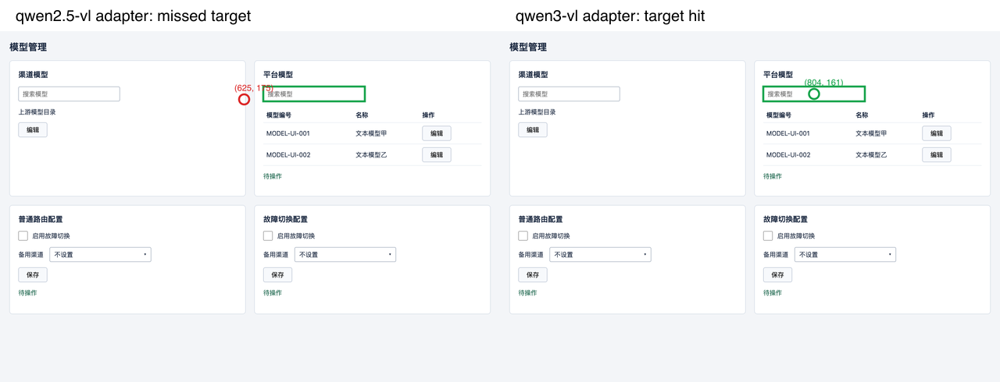

# UI 执行用例格式验证结果

日期：2026-11-14（Asia/Taipei）
关联方案：[面向 Midscene 的 UI 用例执行格式与验证方案](ui-case-execution-contract-plan.md)

后续进展：[代码优化记录](ui-case-execution-contract-implementation.md)包含本报告发现问题的修复与新增验证。本报告保留改造前实验结果。

## 1. 结论

推荐将业务用例转换成“页面 → 区域 → 对象 → 控件 → 单个动作 → 明确结果”的结构化执行用例，再编译成当前 `ai_locate` 支持的 `prompt / intent / text`。

本地真实模型实验支持这一路线，但也证明只改描述不够：

1. 当前 `qwen3.8-omni-flash` 自动使用 `qwen2.5-vl` 适配时，结构化描述的正确操作率只有 **4/18**。
2. 同一模型改用实验性的 `qwen3-vl` 适配后，结构化描述达到 **18/18**；同配置简略描述为 **2/18**。
3. 当前生成器还存在断言串位问题：正确文字出现在另一个字段时，原断言会误通过。执行格式必须贯穿操作、断言、录制与回放的作用域，不能只用于生成提示词。

因此，这套格式可进入接入开发；尚不能宣称真实业务用例已经稳定执行，也不能直接批量转换后放行。

## 2. 实验条件与有效范围

| 项目 | 实际设置 |
| --- | --- |
| 视觉模型 | 桌面端当前配置 `qwen3.8-omni-flash`，使用原配置服务 |
| SDK | `@midscene/web` 1.17.7 |
| 适配组 | 当前自动选择 `qwen2.5-vl`；补充组 `qwen3-vl`，仅在实验进程覆盖 |
| 页面 | 本地可重置 HTML 夹具；中文管理页、原生控件及模拟 Element Plus DOM |
| 浏览器 / 视口 / DPR | Chromium 157.0.8103.52 / 1280 × 900 / 1；独立无头浏览器，不是 Electron 内嵌缩放环境 |
| 目标 | 搜索框、开关、下拉框、选项、指定行编辑按钮、保存按钮 |
| 布局 | 两种区域/列表行排列，按 A/B/A 三轮执行 |
| 组别 | 简略目标词组 vs 由执行用例编译的结构化描述 |
| 控制条件 | 同适配组内保持 intent、text、模型、页面和操作参数一致；交替组别顺序 |
| 缓存与恢复 | 关闭 Midscene 定位缓存；每个单目标样本重建页面；没有人工纠偏或工具层重复尝试 |
| 评分 | DOM 框独立检查原始落点；检查映射后的目标身份；操作后同时检查结果值与实际事件目标 |

共 **72 次真实 `aiLocate` 调用**用于两种适配配置下的单目标 A/B 对照。数字不是供应商 API 请求计数，SDK 内部行为未单独统计。DOM 控制实验不计入视觉成绩。

简略组故意保留同名目标歧义，用于验证作用域描述的价值；它不是历史四条完整任务提示的重跑。因此不能把这个提升比例当作所有现有用例的平均收益。

## 3. 单目标实测

| 模型族适配 | 描述 | 原始落点命中 | 映射目标正确 | 最终操作正确 | 定位耗时中位数 |
| --- | --- | ---: | ---: | ---: | ---: |
| qwen2.5-vl（当前自动配置） | 简略 | 1/18 | 3/18 | 3/18（16.7%） | 10.482 秒 |
| qwen2.5-vl（当前自动配置） | 结构化 | 1/18 | 4/18 | 4/18（22.2%） | 7.073 秒 |
| qwen3-vl（实验配置） | 简略 | 2/18 | 2/18 | 2/18（11.1%） | 4.444 秒 |
| qwen3-vl（实验配置） | 结构化 | 16/18 | 18/18 | 18/18（100%） | 4.188 秒 |

qwen3-vl 结构化组的两次非原始命中发生在开关：落点位于关联标签，现有 `intent=check` 映射到真实复选框后正确设置状态。不能把这两次算作“视觉原始命中”。

qwen3-vl 组每类结构化目标均为 3/3 正确。简略组仅搜索框、保存按钮各有 1 次命中目标，其他同名对象选择没有达到预期身份。错误目标上点击或输入成功，也计作错误操作。

结构化组从 4/18 到 18/18 的跨组提升包含模型族适配影响，不能全部归因于描述格式。同适配组内的 2/18 对 18/18 才是本次对描述方式的比较。定位中位数不等于端到端探索耗时；小样本不作显著性、P95 或稳定提速承诺。

## 4. 坐标适配证据

同一张页面、同一条结构化搜索框描述：

- 目标输入框范围：x=674～934，y=142～180。
- `qwen2.5-vl` 返回 `[625,175]`，落在目标左侧，映射检查失败。
- `qwen3-vl` 返回 `[804,161]`，命中目标中心。



已安装 SDK 中，Qwen 2.5 适配采用未归一化坐标；Qwen 3 适配采用 `normalizedBy: 1000`。该差异与实测偏差一致。模型族还会改变图像预处理和请求参数，本次验证的是适配整体，不是单独证明某一条坐标换算公式，更不是对模型名称做官方兼容认证。

没有修改桌面端全局设置或生产代码中的模型族推断。

## 5. 录制、回放及连续流程

| 验证 | 结果 | 说明 |
| --- | --- | --- |
| 格式与准入测试 | 24/24 通过 | 包含 21 个拒绝执行负例、完整正例、label/text 区分及语义检查边界 |
| 现有 Midscene/组件相关测试 | 6/6 通过 | `midscene.test.ts`、`ui-controls.test.ts` |
| 确定性 DOM 控制实验 | 6/6 操作正确；6/6 回放通过 | 已知坐标，不是视觉成绩 |
| 当前适配的结构化成功样本回放 | 4 份脚本 × 3 轮 = 12/12 | 只说明成功录制的样本可回放，不掩盖其余 14 次探索失败 |
| qwen3-vl 的结构化样本回放 | 18 份脚本 × 3 轮 = 54/54 | 新浏览器上下文，回放不调用模型 |
| 六步流程 DOM 控制实验 | 6/6 步骤；3/3 整体回放 | 每一步保留前一步状态 |
| 六步流程真实模型实验 | 6/6 步骤；3/3 整体回放 | qwen3-vl 适配；单独记录在 flow-results.json |

构建验证：MCP TypeScript 构建、桌面主进程 TypeScript 编译均通过。本次未执行桌面渲染端全量检查，也未修改生产业务实现。

连续流程为：输入模型标识 → 点击指定行编辑 → 设置故障切换为开启 → 打开备用渠道 → 点击“阿里云源” → 保存。增加组件显示选中值检查。夹具没有真实后端，该流程不证明配置持久化或故障切换行为。

连续流程额外使用 6 次真实定位，因此本次真实 `aiLocate` 调用合计 **78 次**。六步操作均命中预期业务目标，重新启动浏览器后的完整脚本回放三次全部通过。

连续流程控制实验首次执行时，夹具缺少适配器所需的 `.el-select__selection` 容器，选中值断言报错。只补齐连续流程夹具的该 DOM 容器后复测通过；原始失败保存在 `flow-control-initial.json`。两个 A/B 组使用的基础夹具未修改，哈希相同。

## 6. 额外发现：断言可能验证到另一个字段

实际生成的选中值断言类似：

```ts
await expect(page.locator('div.el-select__selection', {
  hasText: '阿里云源'
})).toHaveText('阿里云源');
```

反例将“故障切换配置”的值改为“错误渠道”，将“普通路由配置”的值改为“阿里云源”。**原断言仍通过**，因为它依据预期值选择了另一个字段。

实验中改为按身份限定区域后：

```ts
await expect(
  page.locator('[role="region"]', { hasText: '故障切换配置' })
    .locator('.el-select__selection')
).toHaveText('阿里云源');
```

正常值下两种断言都通过；错误字段反例中，限定版本正确失败。这是实验中的候选修正，尚未修改生产定位器生成逻辑。生产还要继续限定具体表单项，保证同一区域多个下拉框时唯一。

该发现意味着“回放通过”仍需结合覆盖与断言身份审查。前面的操作正确率由独立的 DOM 结果和事件目标评分，不依赖这个存在问题的断言，因此不撤销该操作成绩；但不能据此宣称生成脚本已具备完备的业务验收能力。

## 7. 历史四例的处理结果

已核对原始会话中的四条用例，保留 **14 条原始预期**及来源会话名和提示内容哈希。四条都为 `needs_clarification`，没有将缺失信息补造成 ready：

- 筛选分页：补齐角色、数据、关键词、预期集合及分页条件。
- 启用停用：补齐模型身份，拆开页面状态与新请求路由验证。
- 路径校验：修正步骤预期错位，拆分非法输入、合法保存、匹配行为。
- 故障兜底：拆分配置、有/无候选和运行时故障；补齐故障触发、调用次数证据及恢复。

历史样本整理是人工语义审查产物，不是已完成的自动转换器。本次没有对真实 dev 业务数据执行操作。

## 8. 建议落地顺序

1. 接入本方案的执行用例格式、原预期覆盖映射及环境绑定；缺条件用例先停在待澄清。
2. 为视觉模型增加定位校准，选用实测匹配的适配方式；未知模型不静默标记兼容。
3. 将区域、对象、表单项身份传递到操作与断言定位器；阻止“按预期值找任意元素”的断言。
4. 完成真实项目的数据准备和观察手段后，先转换四条样本，再进行同业务覆盖下的探索与回放验收。

本次建议采用该格式，但暂不进行“全部历史用例自动转换后直接执行”。

## 9. 交付物与复现

- [实验实现及运行说明](../scripts/experiments/ui-case-contract/README.md)
- [机器可校验 Schema](evidence/ui-case-contract/2026-11-14/contract.schema.json)
- [六类完整执行用例示例](evidence/ui-case-contract/2026-11-14/fixture-contracts.json)
- [历史用例审查与覆盖保留](evidence/ui-case-contract/2026-11-14/historical-review.json)
- [汇总结果](evidence/ui-case-contract/2026-11-14/summary.json)
- [当前适配逐次结果](evidence/ui-case-contract/2026-11-14/live-results.json)
- [qwen3-vl 逐次结果](evidence/ui-case-contract/2026-11-14/qwen3-vl-results.json)
- [断言反例结果](evidence/ui-case-contract/2026-11-14/assertion-probe-results.json)
- [连续流程执行用例](evidence/ui-case-contract/2026-11-14/flow-contract.json)
- [连续流程实测与回放](evidence/ui-case-contract/2026-11-14/flow-results.json)
- [实际生成的流程脚本](evidence/ui-case-contract/2026-11-14/flow-generated.spec.txt)

截图、Midscene 报告、生成 spec、步骤文件和 Playwright 原始报告在本地 `.release/ui-case-contract/`。文档证据目录只保留核对后的 JSON、合成页面诊断图及流程脚本快照。
